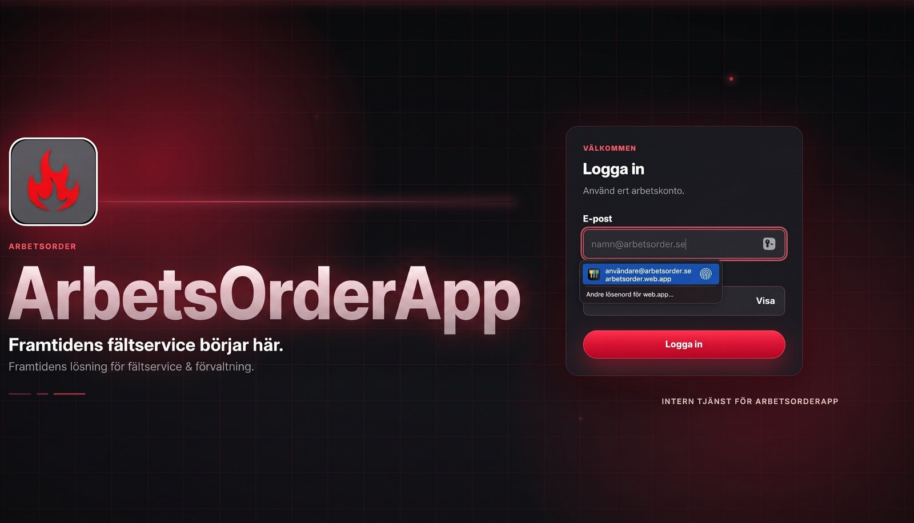
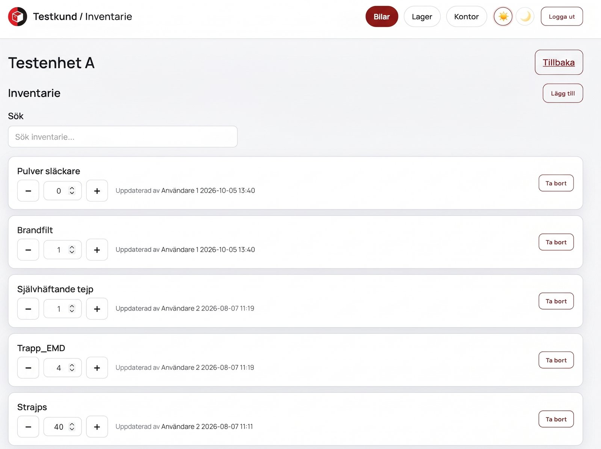
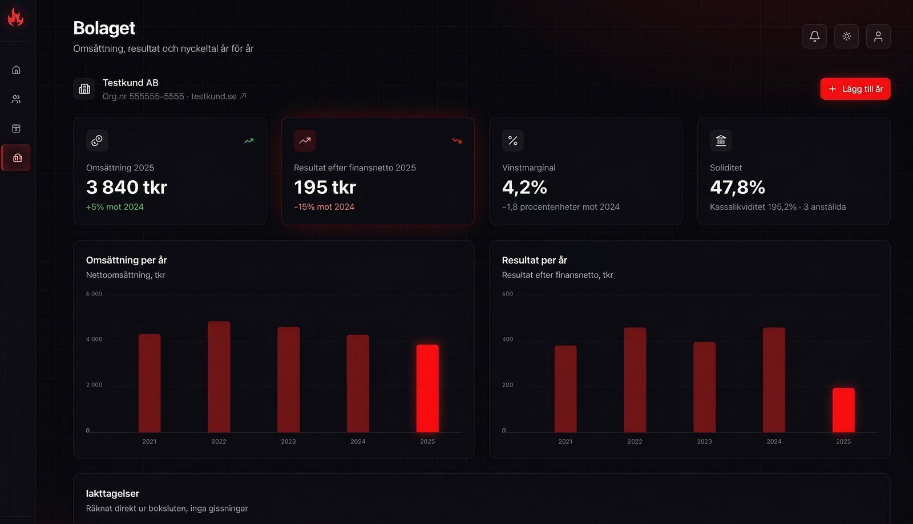
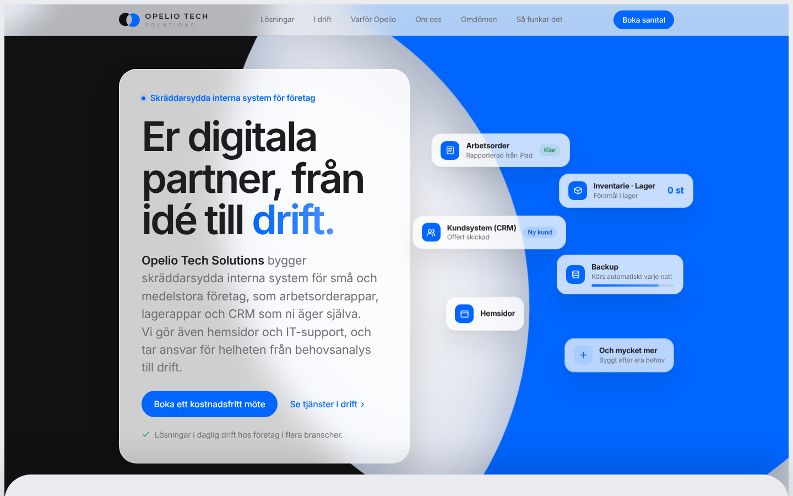
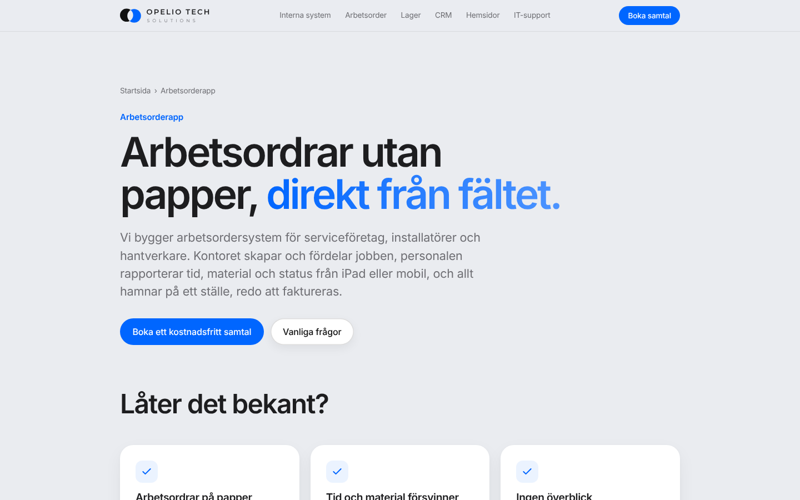
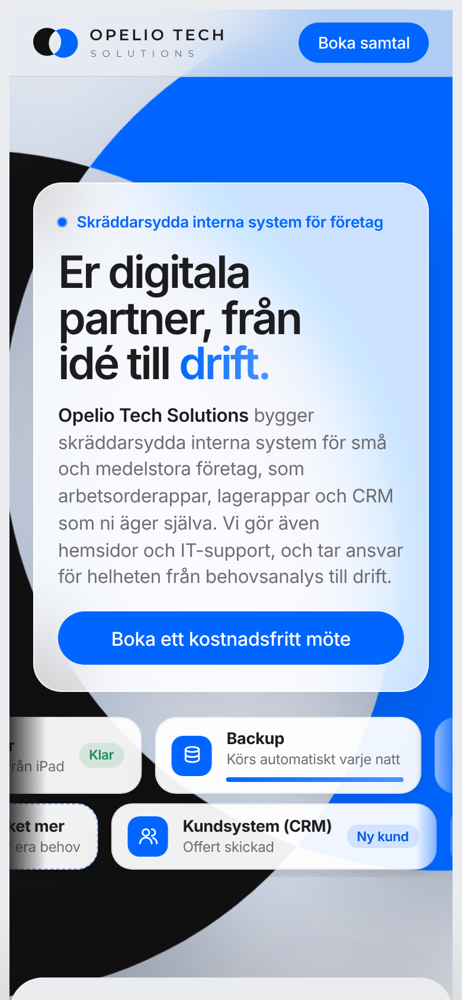

# Portfolio

Websites and internal tools I've built for businesses, with live links and screenshots. Built through [Opelio Tech Solutions](https://opelio.se).

I'm Elliott Livré, a DevOps engineering student in Stockholm. Through Opelio I build tailor-made internal tools for small businesses (1–50 employees) that the customer owns themselves, plus websites and IT support.

Customer source code is not published here. Each project below has a short description, the tech used and, where possible, a live link.

---

## Internal tools

### ProTaskia – work order app

A work order system used daily by a Swedish fire-safety company, replacing paper work orders. Field staff use shared iPads to pick their team for the day, open their work orders and report status, hours, materials and notes. Admins plan the day's teams, create and assign orders, review 90 days of history and mark jobs as invoiced from a desktop view.

- **Users:** field technicians on iPad, admins on desktop
- **Highlights:** role-based access (admin vs. shared field account), staff register kept separate from login accounts, iPad-first UI built for non-technical users
- **Hosting:** Firebase Hosting
- **Status:** in production

### Inventory app

An inventory system for a service company that keeps track of materials in the company cars and in the warehouse, so the team knows what is in stock and where it is.

- **Highlights:** separate views for cars, warehouse and office, change log with name and timestamp on every update, light and dark mode
- **Status:** in production

### CRM system

A customer register built around how a small business actually works: customers, contact history, quotes and follow-ups in one place instead of spread across spreadsheets and inboxes. The company view shows revenue, profit and key ratios year by year, calculated straight from the annual accounts.

### Opelio Lead Finder – native macOS app

An internal sales tool I built for Opelio. It finds Swedish businesses that have no registered website, shows them on a 3D map and moves them through a sales pipeline until they become customers.

- **Features:** search by city and industry, clustered 3D map, saved leads with CSV export, drag-and-drop pipeline, customer register with agreements, revenue forecast (MRR/ARR), analytics, command palette (⌘K)
- **Tech:** Swift, SwiftUI, MapKit, SwiftData, Swift Charts, URLSession and Keychain, no third-party dependencies
- **Data:** Google Maps business data via the Outscraper API, with a local cost guard that requires confirmation before any paid search, and an import path for CSV/JSON exports. API key stored in the macOS Keychain, unsaved data purged after 30 days

---

## Websites

### opelio.se

Company website for Opelio Tech Solutions. A landing page plus service pages for internal systems, work order apps, inventory, CRM, customer portals, websites and IT support.

**Live:** [opelio.se](https://opelio.se)

  
  

- **Tech:** hand-written HTML, CSS and JavaScript (no framework), self-hosted fonts so no visitor data goes to Google
- **Hosting:** Cloudflare Pages with automatic deploys from `main`, DNS on Cloudflare
- **SEO:** schema.org markup, sitemap, robots.txt, `llms.txt` for AI assistants, Google Search Console and Bing Webmaster Tools

### protektia.se

Website for Protektia Brandskydd, a fire-safety company in the Stockholm area. Rebuilt and updated to bring in more customer enquiries.

**Live:** [protektia.se](https://protektia.se)

---

## Contact

- Web: [opelio.se](https://opelio.se)
- Email: [kontakt@opelio.se](mailto:kontakt@opelio.se)
